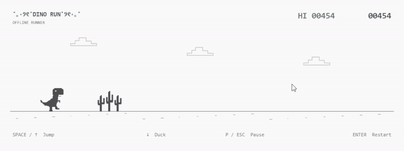

# dinosaur-game (˶ᵔ ᵕ ᵔ˶)

**A little dino, a long way to go...♡**

A Java recreation of Google's classic Dinosaur Game, built with JavaFX.
Dodge cacti and pterodactyls, run into the night, and chase your best score! (ง •̀_•́)ง

<<<<<<< HEAD
<p align="center">
  <a href="docs/gameplay.mp4"></a>
</p>

<p align="center"><sub>▶ <a href="docs/gameplay.mp4">Watch the full run</a> (1 min) (っ˘ω˘ς)</sub></p>

## Gameplay ₍ᐢ•ﻌ•ᐢ₎

- The little dino runs all by itself, so you only have to jump and duck! ε=ε=ε=┌(˶ᵔ ᵕ ᵔ˶)┘
- Cacti pop up along the way. Hop over them (ﾉ>ω<)ﾉ
- From 220 points, pterodactyls fly in, too. Jump or duck under them! ┗(•̀へ •́ )┓
- The longer you run, the faster it gets (ﾟдﾟ;)
- Every 500 points, day turns to night and back again ☾ ⋆｡˚ (－ω－) zzZ
- One bump and it's Game Over... but you can always try again (｡•́︿•̀｡)
=======
## Gameplay

<video src="2026-10-15 22-49-46.mp4" controls width="800"></video>
>>>>>>> 2a434b0a672bb1a49a59613cba26dd6174715e3c

## Let's play! (ﾉ◕ヮ◕)ﾉ*:･ﾟ✧

You'll need **Java 25+**. The launcher can also find the JDK bundled with VS Code's Red Hat Java extension.

Run this from the project folder:

```powershell
powershell -NoProfile -ExecutionPolicy Bypass -File .\run.ps1 play
```

The first launch downloads Maven and JavaFX into `.tools/`.
After that, add `-Offline` to play without internet. (｡•̀ᴗ-)✧

## Tiny paws, big jumps (•ᴗ•)

| Key | Action |
| --- | --- |
| Space / ↑ / W | Jump — hold to go higher! ヽ(•‿•)ノ |
| ↓ / S | Duck or fall faster (・ω・) |
| P / Esc | Pause / resume (˘ᵕ˘) |
| Enter / R | Restart after Game Over / resume |
| Left click | Start, jump, resume, or restart after Game Over |

Switching windows pauses the adventure. Your best score is saved for next time! (´｡• ᵕ •｡`)

## Little checkup (๑•̀ㅂ•́)و✧

Replace `play` in the command above with `test` to run the tests,
`ui-test` to check a real game window, or `verify` to test and build.

More details: [game design](docs/game-design.md) · [requirements](docs/requirements.md)

*rawr! take a little break, then try again ♡ (づ｡◕‿‿◕｡)づ*
